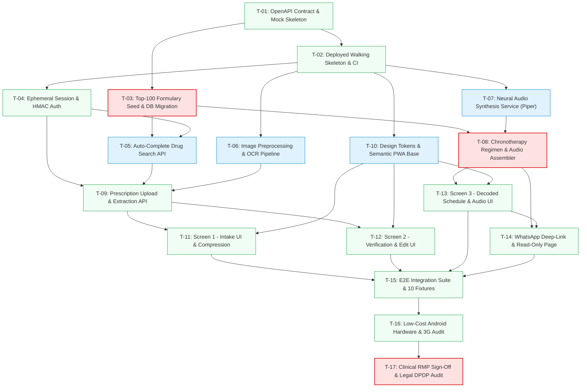

# Engineering Task List & Implementation Roadmap: ReportSaathi
*References: `docs/05-prd.md`, `docs/06-architecture.md`, `docs/06a-api-contract.md`, `docs/06b-safety-rules.md`, `docs/07-test-plan.md`*

---

## 1. Execution Strategy & Work Breakdown

This task list breaks down the implementation of ReportSaathi into **17 bite-sized, sequential and parallel pull requests (PRs)**. 
- Every task is designed to be reviewed independently within a **150–350 line-of-code PR diff**.
- Stack: **Python 3.12 (FastAPI) + Semantic HTML5/CSS/Vanilla JS PWA + SQLite WAL Mode**.
- Dependencies and parallel execution tracks are explicitly marked.
- Any task requiring clinical, legal, or release authorization is prominently flagged with **`[HUMAN APPROVAL REQUIRED]`**.

---

## 2. Dependency Graph & Concurrency Tracks

### Parallel Concurrency Tracks
1. **Track A (Backend & Perception):** While `T-10` (Frontend Tokens) is underway, `T-05` (Search), `T-06` (OCR), and `T-07` (TTS) can be developed completely in parallel.
2. **Track B (Frontend Screens):** `T-11` (Screen 1), `T-12` (Screen 2), and `T-13` (Screen 3) can be built concurrently once `T-09` and `T-10` establish the API interfaces.

---

## 3. Human Approval Gates

| Gate ID | Task ID | Approver Role | Approval Criteria |
| :--- | :--- | :--- | :--- |
| **GATE-1** | `T-03` | Registered Medical Practitioner (RMP) | Verifies accuracy of top-100 formulary indications, chronotherapy meal timings, and red-flag alerts. |
| **GATE-2** | `T-08` | Registered Medical Practitioner (RMP) | Reviews and approves Mad-Lib vernacular audio script templates and hypoglycemia safety triage rules. |
| **GATE-3** | `T-17` | Designated RMP + Legal Counsel | Final production sign-off: Telemedicine Practice Guidelines compliance, CDSCO SaMD exemption, and DPDP Act 2023 data scrub audit. |

---

## 4. Detailed Task Specifications (T-01 to T-17)

### Phase 0: Contract, Toolchain & Walking Skeleton

#### T-01: OpenAPI 3.1 Contract & Mock Server Skeleton
- **PR Title:** `feat(api): define openapi 3.1 contract and mock server endpoints`
- **Owner:** Backend
- **Parallel Group:** None (Foundation)
- **Human Approval Needed:** No
- **Requirements Mapped:** `FR-14`, `FR-15`
- **Tests Mapped:** `TC-FR15-01`
- **Dependencies:** None
- **Scope & Details:**
  - Create `app/main.py` initializing FastAPI 0.115+.
  - Implement mock handlers for the 6 endpoints defined in `docs/06a-api-contract.md` (`/sessions`, `/prescriptions/upload`, `/formulary/search`, `/regimens/decode`, `/audio/{id}.opus`, `/s/{token}`).
  - Add standard `ErrorResponse` schema and custom exception handlers.
  - Expose `/api/v1/health` returning `{ "status": "ok", "version": "1.0.0" }`.
- **Definition of Done (DoD):**
  - [ ] OpenAPI 3.1 spec generated at `/openapi.json` matches `docs/06a-api-contract.md` exactly.
  - [ ] All mock endpoints return valid JSON matching schemas.
  - [ ] Automated contract test verifies statutory disclaimer is present in mock decode payload.

---

#### T-02: Deployed Walking Skeleton & Containerized CI
- **PR Title:** `ci(deploy): containerize walking skeleton with automated test pipeline`
- **Owner:** Backend / DevOps
- **Parallel Group:** None (Foundation)
- **Human Approval Needed:** No
- **Requirements Mapped:** `NFR-01`, `NFR-03`
- **Tests Mapped:** `TC-NFR01-01`
- **Dependencies:** `T-01`
- **Scope & Details:**
  - Create minimal `Dockerfile` based on `python:3.12-slim-bookworm` (under 150MB image).
  - Install OS runtime packages: `tesseract-ocr`, `tesseract-ocr-hin`, `libopus0`.
  - Set up GitHub Actions CI workflow running `ruff` (linter), `mypy` (type checker), and `pytest`.
  - Deploy running walking skeleton to free-tier cloud host (Render / Fly.io / Oracle Cloud).
- **Definition of Done (DoD):**
  - [ ] Container builds successfully without warnings.
  - [ ] Healthcheck endpoint responds with HTTP 200 on public URL.
  - [ ] CI pipeline runs in < 90 seconds.

---

### Phase 1: Data Model & Deterministic Formulary Engine

#### T-03: Top-100 Chronic Formulary Database & Seed Migration
- **PR Title:** `feat(db): create sqlite schema and seed top 100 chronic formulary`
- **Owner:** Database
- **Parallel Group:** Track A
- **Human Approval Needed:** **`YES [GATE-1: RMP Clinical Sign-Off]`**
- **Requirements Mapped:** `FR-03`, `FR-07`, `SR-03`
- **Tests Mapped:** `TC-FR03-01`, `TC-SR03-01`
- **Dependencies:** `T-01`
- **Scope & Details:**
  - Implement SQLite migrations using raw SQL / Alembic for schema defined in `docs/06-architecture.md` (Section 5).
  - Seed database with 100 validated chronic formulations (Diabetes, Hypertension, Dyslipidemia, Thyroid, Cardiac).
  - Populate bilingual metadata: Brand aliases, salt generic names, indications (Hindi/English), meal chronotherapy, benign sensations, red flags.
  - Submit seed dataset to RMP for medical accuracy verification.
- **Definition of Done (DoD):**
  - [ ] All 100 drugs seeded with zero missing fields.
  - [ ] Written approval received from clinical reviewer for medical strings.
  - [ ] Unit test verifies unknown/off-formulary drugs return `FORMULARY_NOT_FOUND`.

---

#### T-04: Ephemeral Session Management & HMAC Authentication
- **PR Title:** `feat(auth): implement ephemeral sessions with hmac-sha256 security`
- **Owner:** Backend
- **Parallel Group:** Track A
- **Human Approval Needed:** No
- **Requirements Mapped:** `FR-14`, `NFR-05`
- **Tests Mapped:** `TC-FR14-01`, `TC-SEC01-01`, `TC-NFR05-01`
- **Dependencies:** `T-02`
- **Scope & Details:**
  - Implement `POST /api/v1/sessions` generating UUIDv4 `session_id` and signed `X-Session-Token` using HMAC-SHA256.
  - Build FastAPI dependency `verify_ephemeral_session` validating headers and checking TTL (`expires_at > CURRENT_TIMESTAMP`).
  - Create background worker task running hourly to delete expired sessions and associated temporary files.
- **Definition of Done (DoD):**
  - [ ] Forged or expired HMAC tokens rejected with HTTP 401 (`INVALID_SESSION`).
  - [ ] Unit test verifies sessions older than 24 hours are purged from SQLite.
  - [ ] Zero persistent user identifiers (no phone number or IP address stored).

---

#### T-05: Fast Auto-Complete Drug Search Service
- **PR Title:** `feat(formulary): implement fuzzy auto-complete search API`
- **Owner:** Backend
- **Parallel Group:** Track A (Concurrent with T-06, T-07)
- **Human Approval Needed:** No
- **Requirements Mapped:** `FR-03`, `NFR-01`
- **Tests Mapped:** `TC-FR03-01`, `TC-SEC02-01`
- **Dependencies:** `T-03`, `T-04`
- **Scope & Details:**
  - Implement `GET /api/v1/formulary/search?q={query}&lang={hi|en}`.
  - Query SQLite using parameterized queries with prefix matching and Levenshtein distance `<= 2`.
  - Enforce minimum 2-character query length and return up to 8 matched results.
  - Sanitize input against SQL injection payloads.
- **Definition of Done (DoD):**
  - [ ] Endpoint responds in `< 50ms` on SQLite test database.
  - [ ] SQL injection payloads (`' OR 1=1 --`) safely handled and return empty array.
  - [ ] Contract test verifies JSON schema matches `docs/06a-api-contract.md`.

---

### Phase 2: Perception Pipelines (OCR & Neural TTS)

#### T-06: Image Preprocessing & Tesseract OCR Pipeline
- **PR Title:** `feat(ocr): build server-side image normalization and ocr extractor`
- **Owner:** AI / Backend
- **Parallel Group:** Track A (Concurrent with T-05, T-07)
- **Human Approval Needed:** No
- **Requirements Mapped:** `FR-02`, `FR-04`, `FR-06`
- **Tests Mapped:** `TC-FR02-01`, `TC-FR04-01`, `TC-FR06-01`, `TC-SEC03-01`
- **Dependencies:** `T-02`
- **Scope & Details:**
  - Build `app/services/ocr.py` using `OpenCV` and `pytesseract`.
  - Pipeline: Grayscale conversion -> Deskewing -> Adaptive Gaussian Thresholding -> Noise removal.
  - Run Tesseract OCR v5 with `--oem 1 -l eng+hin`.
  - Calculate image Laplacian sharpness variance; reject images with score `< 30.0` with HTTP 422 (`OCR_EXTRACTION_FAILED`).
  - Secure file handling: write temporary image to `/tmp/reportsaathi/uploads/{uuid}.jpg` and ensure immediate unlinking in `finally:` block.
- **Definition of Done (DoD):**
  - [ ] Extracts text accurately from test fixtures `fix_01` to `fix_05`.
  - [ ] Rejects blurry fixture `fix_06` with HTTP 422.
  - [ ] Temporary files unlinked from disk immediately post-extraction (verified by automated test).
  - [ ] Client filename path traversal attempts neutralized.

---

#### T-07: Neural Audio Voice Synthesis Service (Piper TTS)
- **PR Title:** `feat(audio): integrate piper neural tts with 32kbps opus streaming`
- **Owner:** AI / Backend
- **Parallel Group:** Track A (Concurrent with T-05, T-06)
- **Human Approval Needed:** No
- **Requirements Mapped:** `FR-10`, `FR-11`, `NFR-02`
- **Tests Mapped:** `TC-FR10-01`, `TC-NFR02-01`
- **Dependencies:** `T-02`
- **Scope & Details:**
  - Build `app/services/audio.py` integrating Piper ONNX runtime with `hi_IN-hindi-medium.onnx` and `en_IN-cpc-medium.onnx`.
  - Add fallback to `edge-tts` if ONNX fails.
  - Encode generated WAV stream into **32 kbps mono Opus in Ogg container** via `ffmpeg`.
  - Implement streaming route `GET /api/v1/audio/{id}.opus` with `Accept-Ranges: bytes`.
- **Definition of Done (DoD):**
  - [ ] Synthesizes 90-second Hindi speech clip in `< 3.5 seconds` on 2 vCPUs.
  - [ ] Output audio payload verified `< 360KB` for 90s clip.
  - [ ] Streaming endpoint returns proper `audio/ogg; codecs=opus` MIME type and supports HTTP 206 partial content.

---

### Phase 3: Core Business Logic & Orchestration

#### T-08: Deterministic Chronotherapy Engine & Audio Script Assembler
- **PR Title:** `feat(schedule): build multi-drug chronotherapy and script assembler`
- **Owner:** Backend
- **Parallel Group:** Core Pipeline
- **Human Approval Needed:** **`YES [GATE-2: RMP Clinical Sign-Off]`**
- **Requirements Mapped:** `FR-07`, `FR-09`, `FR-10`, `SR-01`, `SR-02`, `SR-04`
- **Tests Mapped:** `TC-FR07-01`, `TC-FR09-01`, `TC-FR10-01`, `TC-SR01-01`, `TC-SR02-01`, `TC-SR04-01`, `TC-SR05-01`
- **Dependencies:** `T-03`, `T-07`
- **Scope & Details:**
  - Implement `app/services/scheduler.py` taking confirmed formulary IDs and building morning/afternoon/night timeline.
  - Implement meal chronotherapy rules: empty stomach (thyroxine/PPIs), with first bite (sulfonylureas), after food (ARBs/metformin), bedtime (statins).
  - Separate benign symptoms from red-flag danger warnings.
  - Assemble Mad-Lib audio script using rigid templates; regex-verify that zero unapproved prompt tokens exist.
  - Implement `POST /api/v1/regimens/decode`.
- **Definition of Done (DoD):**
  - [ ] Unit tests verify all 6 drugs in fixture `fix_05` are sorted into correct meal slots.
  - [ ] Adversarial prompt injection fixture `fix_08` completely ignored; zero dose modification possible.
  - [ ] Written RMP sign-off obtained for script templates and emergency alert rules.

---

#### T-09: Prescription Upload & Extraction Orchestration API
- **PR Title:** `feat(api): implement upload endpoint with fuzzy formulary token matcher`
- **Owner:** Backend
- **Parallel Group:** Core Pipeline
- **Human Approval Needed:** No
- **Requirements Mapped:** `FR-04`, `FR-06`
- **Tests Mapped:** `TC-FR04-01`, `TC-FR06-01`, `TC-EDGE02-01`
- **Dependencies:** `T-04`, `T-05`, `T-06`
- **Scope & Details:**
  - Implement `POST /api/v1/prescriptions/upload`.
  - Validate image mime-type (JPEG, PNG, WebP) and enforce 10MB payload limit.
  - Pass image to OCR engine (`T-06`).
  - Extract lines, tokenize, and fuzzy-match against `formulary_drugs` brand aliases.
  - Return list of matched medications with confidence scores and default timing tags.
- **Definition of Done (DoD):**
  - [ ] Correctly identifies medications in fixtures `fix_01`, `fix_02`, `fix_03`, `fix_04`.
  - [ ] Files > 10MB rejected with HTTP 413 (`PAYLOAD_TOO_LARGE`).
  - [ ] Total pipeline execution time `< 8.0 seconds`.

---

### Phase 4: Accessible Frontend Application (Semantic PWA)

#### T-10: Design Tokens & Base Semantic Layout Engine
- **PR Title:** `feat(ui): implement accessible css token system and fluid container`
- **Owner:** Frontend
- **Parallel Group:** Track B (Can run concurrent with T-04, T-05, T-06)
- **Human Approval Needed:** No
- **Requirements Mapped:** `NFR-01`, `NFR-03`, `NFR-04`
- **Tests Mapped:** `TC-NFR01-01`, `TC-NFR03-01`, `TC-NFR04-01`
- **Dependencies:** `T-01`
- **Scope & Details:**
  - Create `app/static/css/tokens.css` with WCAG AAA color variables defined in `docs/04-design.md`.
  - Set system font stack: `Noto Sans Devanagari`, `Noto Sans Tamil`, system-ui.
  - Enforce `line-height: 1.55;`, `word-wrap: break-word;`, and zero text ellipsis.
  - Implement single-column fluid container (`max-width: 480px; margin: 0 auto;`).
  - Create shared header bar with bilingual toggle (`हिंदी / Eng`).
- **Definition of Done (DoD):**
  - [ ] Base CSS file weighs `< 12KB` uncompressed.
  - [ ] Automated contrast check verifies all text meets 7:1 ratio.
  - [ ] Devanagari test strings render with zero vertical matra clipping on 360px viewport.

---

#### T-11: Screen 1: Prescription Intake UI & Client Compression
- **PR Title:** `feat(ui): implement prescription intake screen with client-side image resize`
- **Owner:** Frontend
- **Parallel Group:** Track B
- **Human Approval Needed:** No
- **Requirements Mapped:** `FR-01`, `FR-02`, `FR-03`, `FR-06`
- **Tests Mapped:** `TC-FR01-01`, `TC-FR02-01`, `TC-FR06-01`
- **Dependencies:** `T-09`, `T-10`
- **Scope & Details:**
  - Build Screen 1 matching `docs/04-design.md` ([`screen_01_intake_default.png`](file:///home/jevitapearl/reportsaathi/docs/references/screen_01_intake_default.png)).
  - Implement client-side camera trigger (`<input type="file" accept="image/*" capture="environment">`).
  - Canvas-based client-side image resize downsampling to max 1920px before upload.
  - Build auto-complete search bar connected to `/api/v1/formulary/search`.
  - Implement loading state spinner card and error state retry card.
- **Definition of Done (DoD):**
  - [ ] Client image compression downsizes 8MB photo to `< 300KB` before upload.
  - [ ] Language toggle instantly switches all copy between Hindi and English.
  - [ ] Error state successfully triggers retry camera or manual search picker.

---

#### T-12: Screen 2: Medication Verification & Editing UI
- **PR Title:** `feat(ui): implement medication verification and safety gate screen`
- **Owner:** Frontend
- **Parallel Group:** Track B
- **Human Approval Needed:** No
- **Requirements Mapped:** `FR-05`, `SR-03`
- **Tests Mapped:** `TC-FR05-01`, `TC-SR03-01`
- **Dependencies:** `T-09`, `T-10`
- **Scope & Details:**
  - Build Screen 2 matching `docs/04-design.md` ([`screen_02_verify_default.png`](file:///home/jevitapearl/reportsaathi/docs/references/screen_02_verify_default.png)).
  - Render list of recognized drugs in individual cards with 48x48dp delete button (`हटाएं ✕`).
  - Add `+ कोई दवा छूट गई? जोड़ें` button opening search picker.
  - Enforce human-in-the-loop gate: primary button `"समय समझें ➔"` is disabled if zero medicines are present.
  - Render empty state card when list is cleared ([`screen_02_verify_empty.png`](file:///home/jevitapearl/reportsaathi/docs/references/screen_02_verify_empty.png)).
- **Definition of Done (DoD):**
  - [ ] User can add, edit, or delete recognized medications.
  - [ ] Decode CTA remains disabled until at least 1 valid drug is confirmed.
  - [ ] Touch targets verified `>= 48dp` across all buttons.

---

#### T-13: Screen 3: Decoded Regimen Schedule & Vernacular Audio UI
- **PR Title:** `feat(ui): implement visual schedule cards and persistent audio player`
- **Owner:** Frontend
- **Parallel Group:** Track B
- **Human Approval Needed:** No
- **Requirements Mapped:** `FR-08`, `FR-09`, `FR-11`, `FR-12`
- **Tests Mapped:** `TC-FR08-01`, `TC-FR09-01`, `TC-FR11-01`, `TC-FR12-01`
- **Dependencies:** `T-08`, `T-10`
- **Scope & Details:**
  - Build Screen 3 matching `docs/04-design.md` ([`screen_03_schedule_default.png`](file:///home/jevitapearl/reportsaathi/docs/references/screen_03_schedule_default.png)).
  - Render persistent top audio bar with 48dp green play button, scrubber bar, and time indicator.
  - Render Morning, Afternoon, and Night chronological meal cards.
  - Render Benign Sensations (amber container) and Emergency Red Flags (high-contrast red callout).
  - Implement error fallback: if audio fails, automatically reveal large-type full Hindi transcript ([`screen_03_schedule_error.png`](file:///home/jevitapearl/reportsaathi/docs/references/screen_03_schedule_error.png)).
- **Definition of Done (DoD):**
  - [ ] Audio plays and syncs with scrubber on mobile browsers.
  - [ ] Network disconnect test triggers automatic full-text transcript reveal.
  - [ ] Color contrast verified WCAG AAA (7:1) for all schedule text.

---

#### T-14: WhatsApp Share Deep-Link & Public Read-Only Web View
- **PR Title:** `feat(share): implement whatsapp deep-link and public read-only schedule view`
- **Owner:** Frontend / Backend
- **Parallel Group:** Track B
- **Human Approval Needed:** No
- **Requirements Mapped:** `FR-13`, `FR-15`
- **Tests Mapped:** `TC-FR13-01`, `TC-FR15-01`
- **Dependencies:** `T-08`, `T-13`
- **Scope & Details:**
  - Implement sticky bottom 56dp action: `"📲 पापा को व्हाट्सएप पर भेजें"`.
  - Assemble `whatsapp://send?text=...` URI with polite Hindi summary and public link `https://reportsaathi.org/s/{share_token}`.
  - Build `GET /s/{share_token}` endpoint returning lightweight semantic HTML of the schedule and audio player.
  - Ensure public view operates with zero login or cookie requirement.
- **Definition of Done (DoD):**
  - [ ] Tapping WhatsApp button opens native WhatsApp with pre-filled message.
  - [ ] Shared link opens cleanly on external device without authentication prompt.
  - [ ] Statutory medical disclaimer displayed prominently on public view.

---

### Phase 5: Verification, Hardening & Governance

#### T-15: Master End-to-End Test Suite & Fixture Validation
- **PR Title:** `test(e2e): execute acceptance suite across all 10 anonymized fixtures`
- **Owner:** QA / Backend / Frontend
- **Parallel Group:** Integration Gate
- **Human Approval Needed:** No
- **Requirements Mapped:** All (`FR-01..15`, `NFR-01..05`, `SR-01..08`)
- **Tests Mapped:** All tests in `docs/07-test-plan.md`
- **Dependencies:** `T-11`, `T-12`, `T-13`, `T-14`
- **Scope & Details:**
  - Build automated end-to-end test runner in Python / Playwright.
  - Execute end-to-end journeys across all 10 fixtures in `tests/fixtures/`:
    - `fix_01` (Diabetes + Hypertension)
    - `fix_02` (Cardiac triple therapy)
    - `fix_03` (Hypothyroid empty stomach rule)
    - `fix_04` (SGLT2i hydration alert)
    - `fix_05` (6-drug polypharmacy)
    - `fix_06` (Blurry image error recovery)
    - `fix_07` (Off-formulary oncology rejection)
    - `fix_08` (Adversarial dosing prompt rejection)
    - `fix_09` (Non-diagnostic lab panel)
    - `fix_10` (Tamil vernacular script wrapping)
- **Definition of Done (DoD):**
  - [ ] 100% of test fixtures pass automated assertions.
  - [ ] Zero dosage modifications occur across all test runs.
  - [ ] All safety red lines (`SR-01` to `SR-08`) pass with zero regressions.

---

#### T-16: Low-Cost Android Hardware & 3G Network Throttling Audit
- **PR Title:** `audit(perf): verify low-cost android performance and 3g load budget`
- **Owner:** QA / Manual
- **Parallel Group:** Quality Audit
- **Human Approval Needed:** No
- **Requirements Mapped:** `NFR-01`, `NFR-02`, `NFR-03`, `NFR-04`
- **Tests Mapped:** `TC-NFR01-01`, `TC-NFR02-01`, `TC-NFR03-01`, `TC-NFR04-01`, `TC-EDGE01-01`
- **Dependencies:** `T-15`
- **Scope & Details:**
  - Audit live deployment using Chrome DevTools Lighthouse and physical low-end Android device (Redmi A2 / Samsung Galaxy M04, 2GB RAM).
  - Verify initial transferred payload `< 120KB` gzipped.
  - Verify First Contentful Paint (FCP) `< 1.5 seconds` under 3G throttling.
  - Inspect Devanagari and Tamil typography for matra clipping.
- **Definition of Done (DoD):**
  - [ ] Total initial bundle verified `< 120KB`.
  - [ ] FCP on 3G verified `< 1.4s`.
  - [ ] No layout breaking or text clipping on 360x640 resolution.

---

#### T-17: Clinical Governance Sign-Off & Legal DPDP Audit Gate
- **PR Title:** `compliance(release): obtain rmp clinical sign-off and dpdp legal clearance`
- **Owner:** Clinical Lead / Legal / Product
- **Parallel Group:** Production Release Gate
- **Human Approval Needed:** **`MANDATORY [GATE-3: RMP & Legal Counsel Sign-Off]`**
- **Requirements Mapped:** `SR-01`, `SR-02`, `SR-03`, `SR-04`, `SR-05`, `NFR-05`
- **Tests Mapped:** `TC-SR01-01`, `TC-SR02-01`, `TC-SR03-01`, `TC-SR04-01`, `TC-SR05-01`, `TC-NFR05-01`
- **Dependencies:** `T-15`, `T-16`
- **Scope & Details:**
  - Conduct formal clinical walkthrough with Registered Medical Practitioner (RMP).
  - Verify statutory safe-harbor compliance with Telemedicine Practice Guidelines (2020) and CDSCO SaMD exemption.
  - Conduct legal review of DPDP Act 2023 compliance (zero persistent storage, 15-minute image wipe, 24-hour session purge).
  - Publish named clinical board members and credentials in footer.
- **Definition of Done (DoD):**
  - [ ] Formal written approval signed by designated RMP.
  - [ ] Legal counsel clearance memo for DPDP Act 2023.
  - [ ] Production deployment authorized and tagged `v1.0.0-mvp`.
